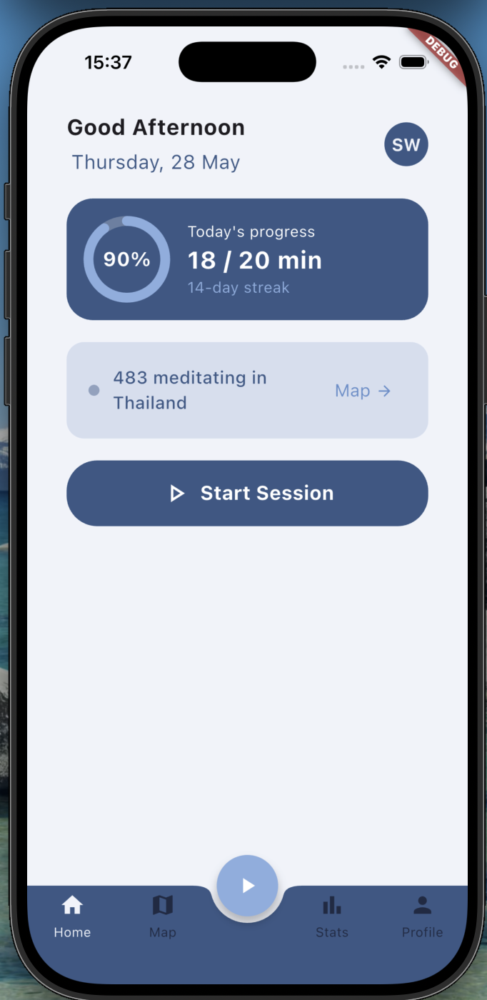
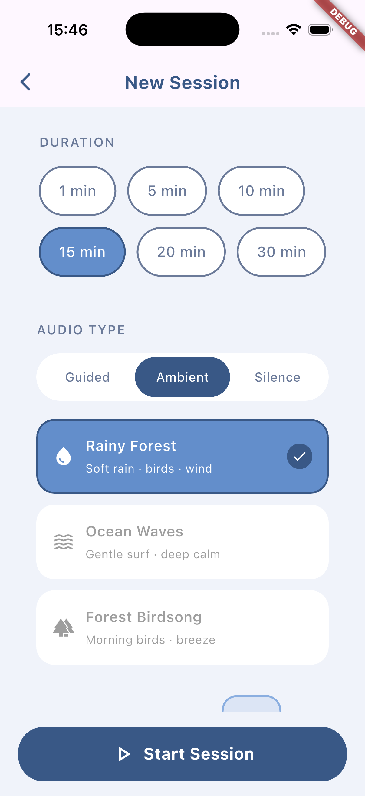
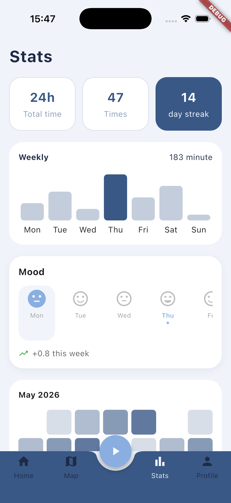

# 🧠 JotJai App

A mindfulness & journaling Flutter application designed to help users reflect their mood, relax with guided sessions, and track their mental wellness over time.

---

## 📱 Features

* 🎧 Guided meditation / focus sessions with audio
* 😊 Mood selection after each session
* ⏱ Session timer with pause & resume
* 🧘 Reflection screen for journaling
* 📊 Weekly mood tracking overview

---

## 📸 Screenshots


| Home                         | Session                         | Result                         |
| ---------------------------- | ------------------------------- | ------------------------------ |
|  |  |  |

---

## 🚀 Getting Started

### Prerequisites

* Flutter SDK (3.x or later)
* Dart SDK

### Installation

```bash
git clone https://github.com/your-username/jot_jai_app.git
cd jot_jai_app
flutter pub get
flutter run
```

### Firebase Authentication

The app uses Firebase Authentication with email and password. Before running
it:

The Firebase Flutter plugins are kept on the `3.x` (`firebase_core`) and `5.x`
(`firebase_auth`) release lines to retain iOS 13 support. Do not upgrade these
to newer major versions unless you are ready to raise the minimum iOS version.

1. In Firebase Console, open **Authentication → Sign-in method** and enable
   **Email/Password**.
2. Install the Firebase CLI in your user directory, sign in, and install
   FlutterFire CLI:

   ```bash
   npm install --prefix "$HOME/.npm-global" firebase-tools
   export PATH="$HOME/.npm-global/node_modules/.bin:$PATH"
   firebase login
   dart pub global activate flutterfire_cli
   ```

3. From the project root, configure the Firebase project:

   ```bash
   flutterfire configure --project=jot-jai-app --platforms=android,ios,web
   ```

   This generates `lib/firebase_options.dart` and the platform-specific
   Firebase configuration files.
4. For web development, add `localhost` under
   **Authentication → Settings → Authorized domains** if it is not already
   listed. Add your deployed web domain there before publishing.
5. Fetch packages and run the app:

   ```bash
   flutter pub get
   flutter run
   ```

If you add another platform later, rerun `flutterfire configure` with that
platform included.

---

## 🧱 Tech Stack

* **Framework:** Flutter
* **Language:** Dart
* **Architecture:** Feature-based structure
* **State Management:** (Provider / Riverpod / Bloc)

---

## 📂 Project Structure

```bash
lib/
 ├── core/        # shared utils, theme, constants
 ├── features/    # feature modules (session, mood, etc.)
 └── main.dart
```

---

## 🎯 Future Improvements

* 🔔 Daily reminder notifications
* ☁️ Cloud sync (Firebase / Supabase)
* 📈 Mood analytics dashboard
* 🔐 User authentication

---

## 👨‍💻 Author

**Suriya Wongaiyara**
Flutter Developer

---

## 📄 License

This project is licensed under the MIT License.